# Gozero Assistant · 2.0

**English** | [简体中文](README.zh-CN.md)

A compact Windows GPU / CPU mining assistant with hardware monitoring, independent GPU + CPU tasks, pool account data, a rental marketplace and a floating desktop monitor.

[Download for Windows](https://github.com/AlexZeroZero/GozeroAssistant/releases/tag/v2.0) · [Website](https://gozero.trade/) · [User guide](desktop/QUICKSTART.txt) · [Build guide](desktop/README.md)

## Download and upgrade

Download `GozerAssistant-2.0.0-win-x64.zip`, verify the accompanying SHA256 checksum, extract the entire archive to a new folder and run `GozerAssistant.exe`. Exit the old app from its tray menu before upgrading. Existing local wallet/pool settings are preserved. Mining never starts automatically on app launch.

Public version: **2.0**; internal version: **2.0.0**. Future releases use **2.1, 2.2, 2.3…** (internal **2.1.0, 2.2.0, 2.3.0…**).

## What's new in 2.0

- **JTM / Jetsam CPU mining:** Gozero JTM CPU 0.3.1-gozero.3, built from TowerMiner, with the Gozero HTTPS JSON-RPC pool as default. Previously saved HTTP URLs for this endpoint are repaired automatically in single and dual profiles.
- **Thread tuning guidance:** explains TowerWalk's 512 KiB workspace, caches, SMT contention and how to compare thread counts. More threads and a 100% budget do not guarantee the highest rate. Suggested counts are test candidates, not measured optimal settings.
- **Refined workspace:** searchable CPU/GPU coin directory, independent task views, consistent kernel-library actions, and Chinese / English / Japanese / Russian interface support.
- **Smaller Windows package:** retains the required language files and losslessly compresses the bundled MDS source archive. Mining executables are unchanged from the last locally validated build.
- **Validation:** 212 application tests passed. JTM UI and offline benchmark checked; the preceding HTTPS fix received 3 accepted / 0 rejected live shares with this same JTM core. This is not payment or full service-fee-cycle verification.

JTM may pause while its pool returns `code 20: node preparing work; retry` during a block transition. This release does not modify the pool server or eliminate that wait. It also does not claim a fix for transient error-state hashrate display. Native relay-test limitations are documented in [validation](docs/release-2.0-validation.txt).

The software service fee remains 0.5%. MDS retains core 0.1.12-rc.2 and the validated RTX 3090 profile. The standalone MDS Linux archive below is unchanged from 1.0.49.

### Linux quick start

Download `GozeroMdsCore-0.1.12-rc.2-linux-x64.tar.gz` and its `.sha256` from this release. Requires x86-64 glibc 2.31+, a compatible NVIDIA GPU/driver (PTX9.0) and Python 3.8+ for supervision; no CUDA Toolkit required.

```bash
sha256sum -c GozeroMdsCore-0.1.12-rc.2-linux-x64.tar.gz.sha256
tar -xzf GozeroMdsCore-0.1.12-rc.2-linux-x64.tar.gz
cd GozeroMdsCore-0.1.12-rc.2-linux-x64
cp config.example.json config.json
# Edit your reusable MSS wallet, mss_confirmed=true and unique worker_prefix.
python3 run-miner.py --config config.json --check
python3 run-miner.py --config config.json
```

Ctrl+C stops owned miners. The supervisor defaults to an 85°C stop, 70°C restart threshold and 90% compute budget. Read [Linux deployment instructions](desktop/experiments/midstate/linux/README.txt) before using `deploy.yml`. Deploying with Ansible defaults to stopped; `mds_start=true` explicitly enables mining. This release uses the Gozero/native pool protocol; the LuckyPool experimental adapter is not included.

| Coin | Hardware / algorithm | Engine / default connection |
| --- | --- | --- |
| JTM | CPU / TowerWalk, 512 KiB per chain | Gozero JTM CPU 0.3.1-gozero.3; `https://jtm.pool.gozero.trade/rpc` |
| MDS | NVIDIA RTX 30/40/50 / million-round BLAKE3 chain | Gozero MDS CUDA 0.1.12-rc.2; `stratum+tcp://mds.gozero.trade:13333` |
| BNT | CPU / Argon2id, 2 GiB per thread | Gozero Blocknet CPU or optional Seine; `stratum+tcp://bnt.pool.gozero.trade:14444` |
| ZCD | CPU / RandomX v2 | Gozero XMRig CPU or official XMRig; `stratum+tcp://zcd.pool.gozero.trade:3333` |
| YSR | NVIDIA SM 8.0+ / SHA-256d | Gozero YSR CUDA; `https://ysr.pool.gozero.trade:8443` |
| NOID | Supported NVIDIA GPUs / Poseidon2b | Suprminer or Fl4shMiner; primary / backup selection |
| PRL / QTC | Upstream-supported GPUs | KRig; regional and backup pool options |

YSR requires a CUDA 13-compatible driver; AMD/CPU YSR and Windows TSC mining are not enabled. ZCD needs at least 4 GiB available RAM. BNT reserves roughly 2 GiB + 128 MiB per thread plus system headroom; more threads do not always mean more hashrate.

## Current interface

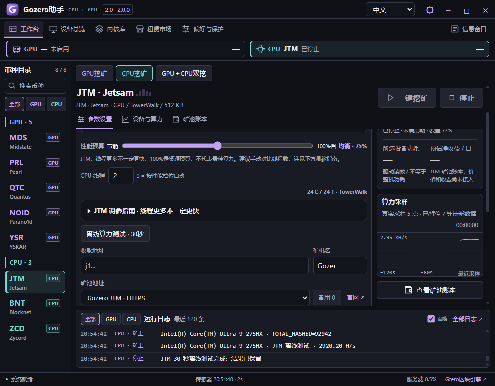

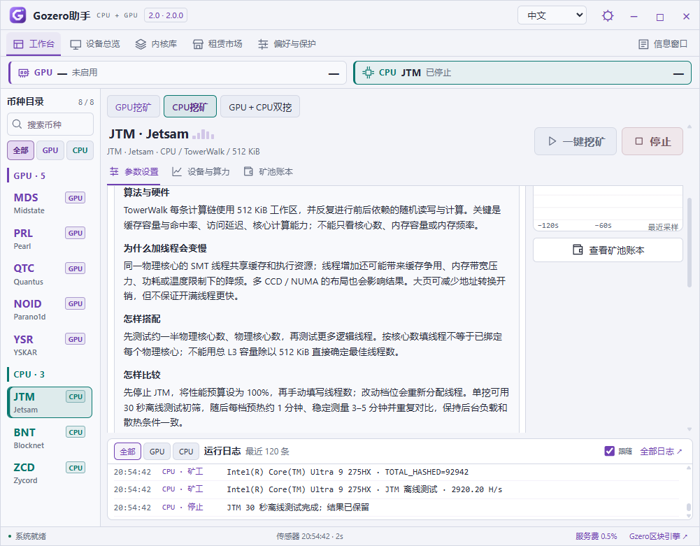


1.0.49 MDS workbench and kernel library, idle UI validation; no mining started in these screenshots.

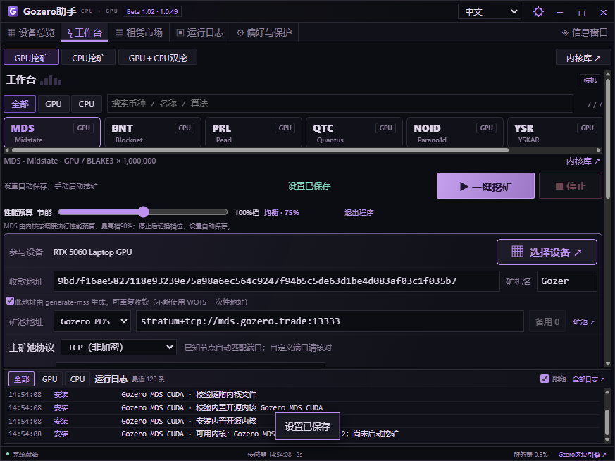

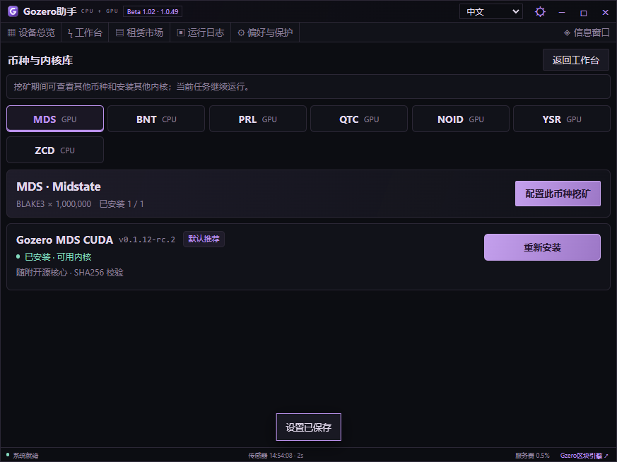

1.0.42 protocol selector (idle; no mining started).

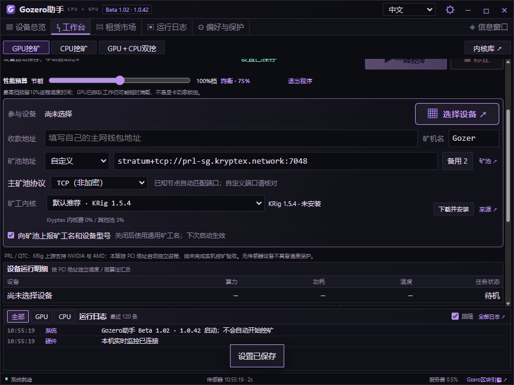

1.0.41 interface, idle. The log-filter image contains explicitly labeled UI-test messages; no mining was started.

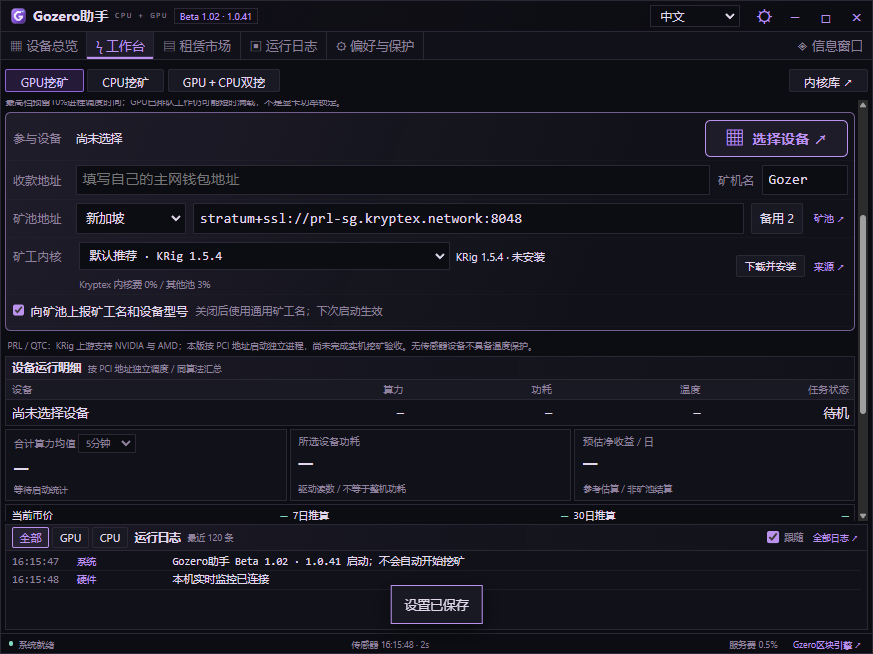

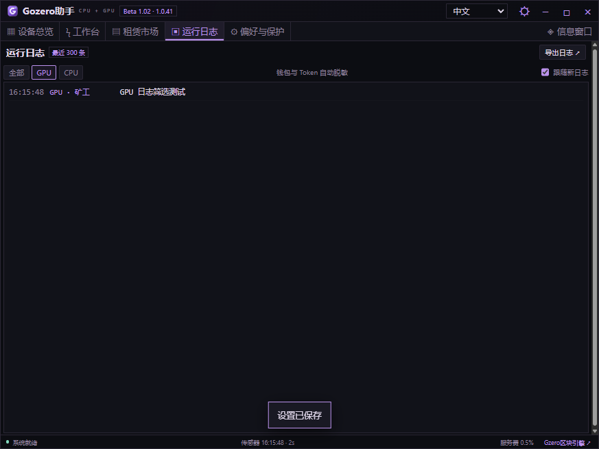

1.0.40 automatic-save workbench (idle; no mining started):

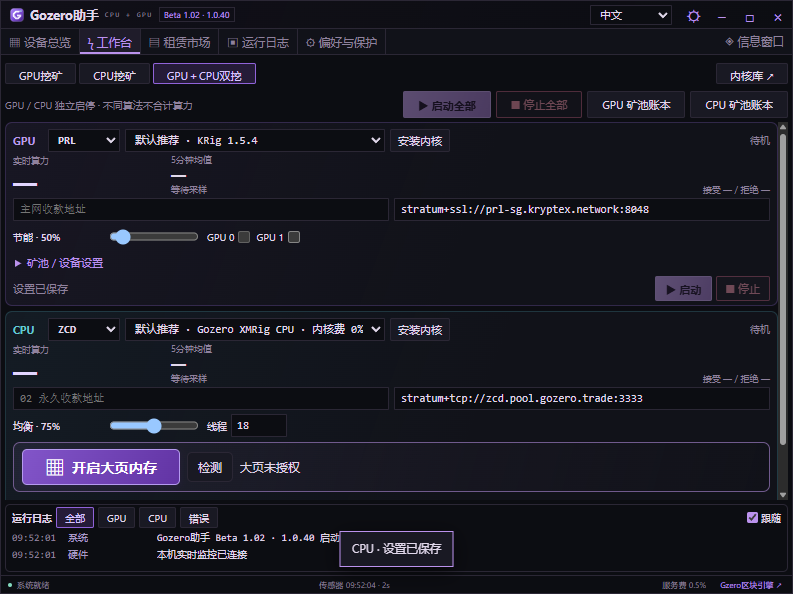

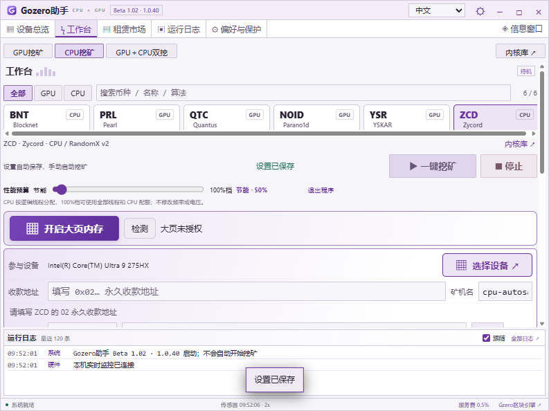

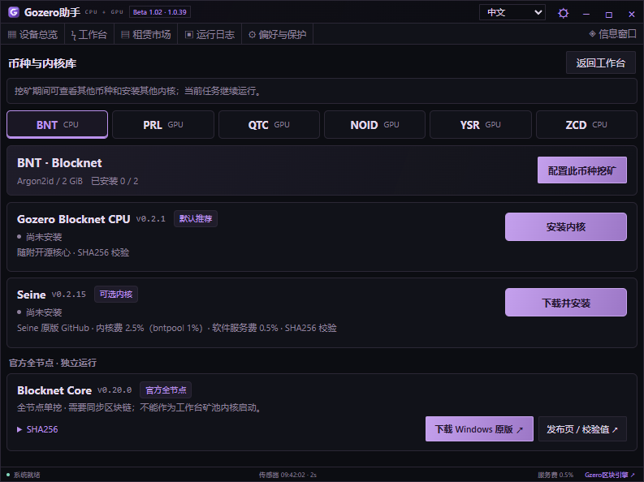


These **1.0.38 screenshots show real read-only pool data for a configured public test address while local mining is idle**. Pool estimates and past ledger amounts do not establish new earnings or local mining speed.

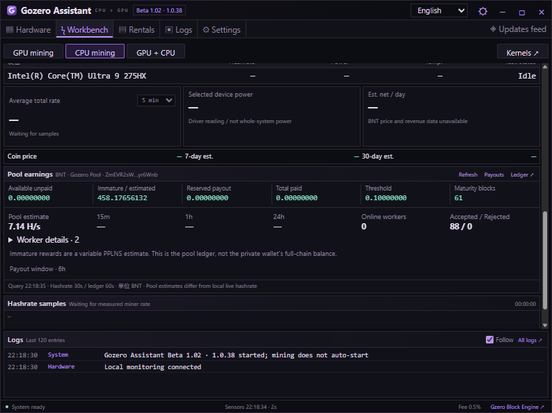

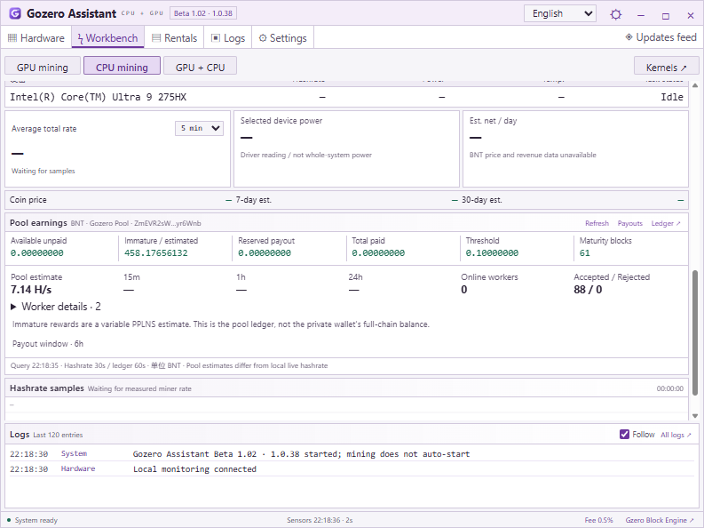

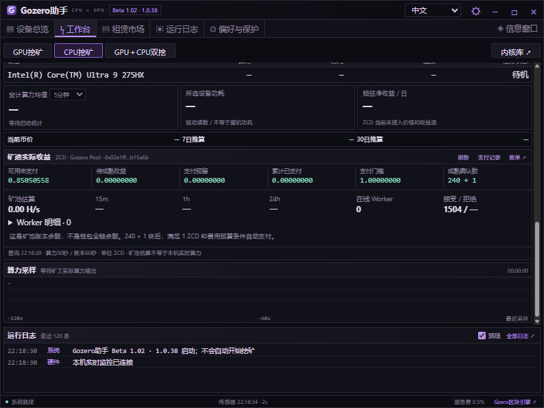

## Other features

- Independent GPU + CPU configurations, start/stop controls, logs and five-/ten-minute hashrate averages. Rates from different algorithms are not added together.
- Hardware inventory, supported live sensors, a draggable floating monitor, system tray controls and a 90°C default GPU protection threshold. CPU temperature and power monitoring are not integrated.
- Chinese, English, Japanese and Russian interfaces; dark and light themes.
- Clore / Vast.ai GPU and CPU rental listings, model filters and rental estimates. The app does not rent or pay automatically.

[Clore referral](https://clore.ai/register?ref_id=ebgzlv4d) · [Vast.ai referral](https://cloud.vast.ai/?ref_id=133254)

## Fees and verification limits

Gozero charges a disclosed **0.5% mining-time service fee**. This is not an exact per-coin payout deduction. Engine fees, pool fees and electricity costs are separate. Gozero BNT has 0% engine fee; original Seine has **2.5%** (1% on bntpool.com/subdomains). Original XMRig has 1%; the optional Gozero CPU build has 0% engine fee.

Earlier 1.0.42 protocol-selection UI checks passed. The 1.0.38 read-only pool/API checks also passed. **Seine's launch inside the Assistant was blocked on the test host (Windows error 5 and a Tencent security prompt); its end-to-end in-app mining has not been accepted there.** No security settings were bypassed. BNT performance gains vary by device and thread count; no 3995WX or AVX-512 improvement is promised. See [validation scope](desktop/VALIDATION.md).

## Source and building

```powershell
git clone https://github.com/AlexZeroZero/GozeroAssistant.git
cd GozeroAssistant
python desktop/scripts/restore-mds-bundle.py
python desktop/scripts/package.py
```

Windows x64, Python 3.11+ and the .NET Framework C# compiler are required. Tests require Node.js 22+. The build verifies a pinned Electron runtime and does not start mining.

Assistant code is [MIT](LICENSE). Upstream components retain their own licenses; see [third-party notices](desktop/THIRD-PARTY.md). Gozero XMRig follows GPL-3.0-or-later: [optional engine and corresponding source](https://github.com/AlexZeroZero/GozeroAssistant/releases/tag/xmrig-cpu-6.26.0-cpu.2). KRig, Suprminer, Fl4shMiner, XMRig and Seine download only at the user's request. Mining software can trigger antivirus detection; no detection-free guarantee is made.

The explicit restoration command downloads the SHA256-pinned MDS bundle; it never runs the miner. MDS is GPL-3.0-only, with its [editable source](desktop/experiments/midstate), [build instructions](desktop/experiments/midstate/CUDA-BUILD.txt) and complete dependency source archive in this release.
