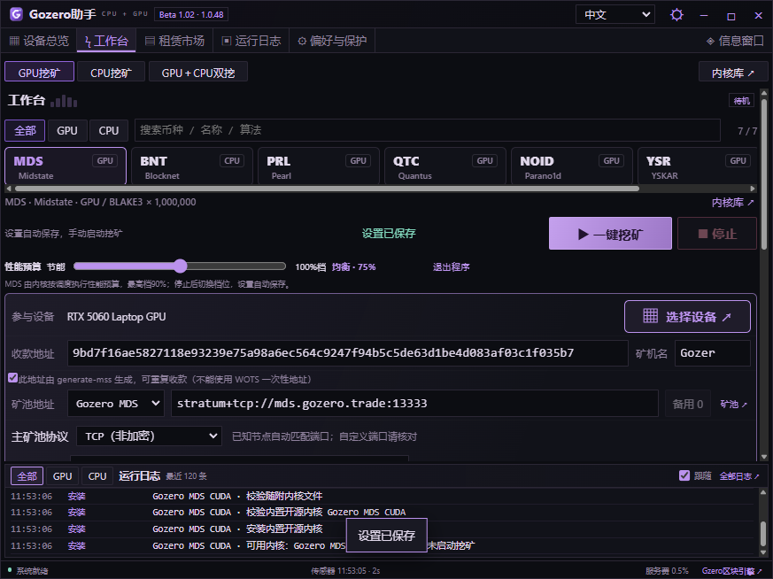

# Gozero Assistant · Beta 1.02 (1.0.48)

**English** | [简体中文](README.zh-CN.md)

A compact Windows GPU / CPU mining assistant with hardware monitoring, independent GPU + CPU tasks, pool account data, a rental marketplace and a floating desktop monitor.

[Download for Windows](https://github.com/AlexZeroZero/GozeroAssistant/releases/tag/v1.0.48-beta) · [Website](https://gozero.trade/) · [User guide](desktop/QUICKSTART.txt) · [Build guide](desktop/README.md)

## Download and upgrade

Download `GozerAssistant-1.0.48-win-x64.zip`, verify the accompanying SHA256 checksum, extract the entire archive to a new folder and run `GozerAssistant.exe`. Exit the old app from its tray menu before upgrading. Existing local wallet/pool settings are preserved. Mining never starts automatically on app launch.

The display version remains **Beta 1.02**; the internal update version is **1.0.48**.

## What's new

- **MDS mining:** Gozero MDS CUDA 0.1.11 supports compatible NVIDIA RTX 30/40/50 GPUs, with `stratum+tcp://mds.gozero.trade:13333` as the default pool. A reusable MSS payout address and explicit confirmation are required. MDS price/income estimates are not integrated.
- **Measured CUDA scheduling:** select loop unroll, batch size, thread-block size and dispatch length on the actual GPU. Full million-round consensus, CPU candidate verification and the existing 90% maximum GPU compute budget are preserved.
- **Pool congestion handling:** a small pending-share window and paced submissions; explicit verifier-busy replies lower concurrency and apply cooldown across reconnects. Rejected or unconfirmed shares are not counted as accepted or automatically resubmitted.
- **Readable diagnostics:** startup and periodic logs include U/block/dispatch/batch settings and queue/acknowledgement state. Existing MDS engine selections migrate to the new recommended version.
- **Measured limits:** the local RTX 5060 Laptop old/new/new/old comparison was 4467.32 versus 4469.96 N/s (+0.06%, effectively unchanged). No significant speedup or RTX 3090/4090 result is claimed for this build. A finite pool check recorded 3 accepted shares and 11 verifier-busy rejections; server-side verification remains an issue to investigate.

203 application regression tests, 6 scheduling/budget tests, 11 protocol tests, 2 CPU consensus tests and 4 CUDA tests passed. The real UI/install check and all 332 packaged-file hashes passed. The publication checkout rerun passed 202 tests with one optional KRig-archive test skipped because that fixture is not included. See [MDS validation](docs/mds-1.0.48-validation.txt).

| Coin | Hardware / algorithm | Engine / default connection |
| --- | --- | --- |
| MDS | NVIDIA RTX 30/40/50 / million-round BLAKE3 chain | Gozero MDS CUDA 0.1.11; `stratum+tcp://mds.gozero.trade:13333` |
| BNT | CPU / Argon2id, 2 GiB per thread | Gozero Blocknet CPU or optional Seine; `stratum+tcp://bnt.pool.gozero.trade:14444` |
| ZCD | CPU / RandomX v2 | Gozero XMRig CPU or official XMRig; `stratum+tcp://zcd.pool.gozero.trade:3333` |
| YSR | NVIDIA SM 8.0+ / SHA-256d | Gozero YSR CUDA; `https://ysr.pool.gozero.trade:8443` |
| NOID | Supported NVIDIA GPUs / Poseidon2b | Suprminer or Fl4shMiner; primary / backup selection |
| PRL / QTC | Upstream-supported GPUs | KRig; regional and backup pool options |

YSR requires a CUDA 13-compatible driver; AMD/CPU YSR and Windows TSC mining are not enabled. ZCD needs at least 4 GiB available RAM. BNT reserves roughly 2 GiB + 128 MiB per thread plus system headroom; more threads do not always mean more hashrate.

## Current interface

1.0.48 MDS workbench and kernel library, idle UI validation; no mining started in these screenshots.




1.0.42 protocol selector (idle; no mining started).


1.0.41 interface, idle. The log-filter image contains explicitly labeled UI-test messages; no mining was started.


1.0.40 automatic-save workbench (idle; no mining started):


These **1.0.38 screenshots show real read-only pool data for a configured public test address while local mining is idle**. Pool estimates and past ledger amounts do not establish new earnings or local mining speed.


## Other features

- Independent GPU + CPU configurations, start/stop controls, logs and five-/ten-minute hashrate averages. Rates from different algorithms are not added together.
- Hardware inventory, supported live sensors, a draggable floating monitor, system tray controls and a 90°C default GPU protection threshold. CPU temperature and power monitoring are not integrated.
- Chinese, English, Japanese and Russian interfaces; dark and light themes.
- Clore / Vast.ai GPU and CPU rental listings, model filters and rental estimates. The app does not rent or pay automatically.

[Clore referral](https://clore.ai/register?ref_id=ebgzlv4d) · [Vast.ai referral](https://cloud.vast.ai/?ref_id=133254)

## Fees and verification limits

Gozero charges a disclosed **0.5% mining-time service fee**. This is not an exact per-coin payout deduction. Engine fees, pool fees and electricity costs are separate. Gozero BNT has 0% engine fee; original Seine has **2.5%** (1% on bntpool.com/subdomains). Original XMRig has 1%; the optional Gozero CPU build has 0% engine fee.

Earlier 1.0.42 protocol-selection UI checks passed. The 1.0.38 read-only pool/API checks also passed. **Seine's launch inside the Assistant was blocked on the test host (Windows error 5 and a Tencent security prompt); its end-to-end in-app mining has not been accepted there.** No security settings were bypassed. BNT performance gains vary by device and thread count; no 3995WX or AVX-512 improvement is promised. See [validation scope](desktop/VALIDATION.md).

## Source and building

```powershell
git clone https://github.com/AlexZeroZero/GozeroAssistant.git
cd GozeroAssistant
python desktop/scripts/restore-mds-bundle.py
python desktop/scripts/package.py
```

Windows x64, Python 3.11+ and the .NET Framework C# compiler are required. Tests require Node.js 22+. The build verifies a pinned Electron runtime and does not start mining.

Assistant code is [MIT](LICENSE). Upstream components retain their own licenses; see [third-party notices](desktop/THIRD-PARTY.md). Gozero XMRig follows GPL-3.0-or-later: [optional engine and corresponding source](https://github.com/AlexZeroZero/GozeroAssistant/releases/tag/xmrig-cpu-6.26.0-cpu.2). KRig, Suprminer, Fl4shMiner, XMRig and Seine download only at the user's request. Mining software can trigger antivirus detection; no detection-free guarantee is made.

The explicit restoration command downloads the SHA256-pinned MDS bundle; it never runs the miner. MDS is GPL-3.0-only, with its [editable source](desktop/experiments/midstate), [build instructions](desktop/experiments/midstate/CUDA-BUILD.txt) and complete dependency source archive in this release.
