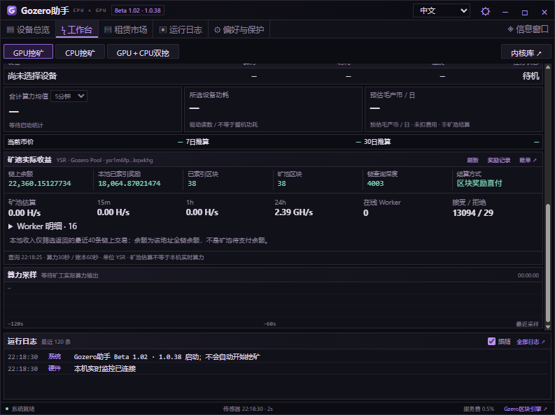

# Gozero助手 · Beta 1.02（1.0.49）

[English](README.md) | **简体中文**

紧凑型 Windows GPU / CPU 挖矿助手，提供硬件监测、GPU＋CPU 独立双挖、矿池账本、租赁市场与桌面悬浮监控。

[下载 Windows 版](https://github.com/AlexZeroZero/GozeroAssistant/releases/tag/v1.0.49-beta) · [官网](https://gozero.trade/) · [使用指南](desktop/QUICKSTART.txt) · [构建说明](desktop/README.md)

## 下载与升级

下载 `GozerAssistant-1.0.49-win-x64.zip`，核对随附 SHA256，完整解压到新目录，运行 `GozerAssistant.exe`。升级前从托盘退出旧版。已有钱包、矿池与设置保留；程序不会自动开始挖矿。显示版本仍为 **Beta 1.02**，内部版本 **1.0.49**。

## 本版更新

- **已验证的 MDS rc2**：优化整数指令调度与 CUDA 分段排队，保留百万轮计算、完整 CPU 候选复核和真实工作量统计。
- **3090 实测参数**：U2 / B256 / D4000 / N20992；其它显卡保持启动调优，旧 MDS 内核选择迁移至默认推荐。
- **独立 Linux x86-64 内核**：原生 ELF、每卡独立进程、JSON 配置、温控与重复启动检查、systemd 服务和 Ansible 批量部署示例。默认矿池 `stratum+tcp://mds.gozero.trade:13333`。
- **验证结果**：203 项 Windows 回归、实际待机界面/安装和325个打包文件校验通过。Linux 24项核心测试、5项守护脚本测试及部署语法通过；WSL2 / RTX5060Laptop 在30%预算下矿池测试收到3个接受、0拒绝。尚未验证裸机 Linux 与真实多机矿场部署。
- **性能边界**：此前 Windows 3090 同条件对照中 rc2 在90%计算预算下平均16.768K N/s，相比 rc1 高2.91%（不是与已发布0.1.11的直接对比）。两轮100%预算短测平均18.279K N/s，约351W、最高84°C；不能视为长期有效算力或收益保证，未实测4090。后续仅有微小差异的 foldswap 实验没有合入。

助手最高档仍为90%计算预算，软件服务费仍为0.5%；独立 Linux 核心/脚本不含抽水调度。详见[验证记录](docs/mds-1.0.49-validation.txt)。

### Linux 使用

下载 `GozeroMdsCore-0.1.12-rc.2-linux-x64.tar.gz` 及其 `.sha256`。要求 x86-64、glibc2.31+、兼容 NVIDIA 显卡和支持PTX9.0的驱动，守护脚本需要Python3.8+；无需CUDA Toolkit。

```bash
sha256sum -c GozeroMdsCore-0.1.12-rc.2-linux-x64.tar.gz.sha256
tar -xzf GozeroMdsCore-0.1.12-rc.2-linux-x64.tar.gz
cd GozeroMdsCore-0.1.12-rc.2-linux-x64
cp config.example.json config.json
# 填写自己的MSS可重复收款地址、mss_confirmed=true、唯一worker_prefix。
python3 run-miner.py --config config.json --check
python3 run-miner.py --config config.json
```

Ctrl+C 停止。默认85°C停止、70°C以下允许重启、90%计算预算；批量部署说明见[Linux指南](desktop/experiments/midstate/linux/README.txt)。Ansible默认部署后保持停止，明确传入 `mds_start=true` 才启用挖矿。本包适配Gozero/native矿池协议，不含LuckyPool实验适配器。

| 币种 | 设备 / 算法 | 内核与默认矿池 |
| --- | --- | --- |
| MDS | NVIDIA RTX 30/40/50 / 百万轮 BLAKE3 链 | Gozero MDS CUDA 0.1.12-rc.2；`stratum+tcp://mds.gozero.trade:13333` |
| BNT | CPU / Argon2id，每线程2 GiB | 自研核心或 Seine；`stratum+tcp://bnt.pool.gozero.trade:14444` |
| ZCD | CPU / RandomX v2 | Gozero XMRig CPU 或官方 XMRig；`stratum+tcp://zcd.pool.gozero.trade:3333` |
| YSR | NVIDIA SM 8.0+ / SHA-256d | Gozero YSR CUDA；`https://ysr.pool.gozero.trade:8443` |
| NOID | 受支持 NVIDIA / Poseidon2b | Suprminer 或 Fl4shMiner，支持主备选择 |
| PRL / QTC | 上游支持的 GPU | KRig，支持地区节点和备用矿池 |

YSR 需要兼容 CUDA 13 的驱动，未开放 AMD/CPU；TSC Windows 未开放。ZCD 至少需要4 GiB可用内存；BNT 约2 GiB＋128 MiB/线程并预留系统内存。线程越多不一定越快。

## 当前界面

1.0.49 MDS 工作台与内核库，待机界面验证截图；截图过程中未启动挖矿。


1.0.42协议选择界面（待机，未启动挖矿）。


1.0.41待机界面。日志截图为已标明的筛选测试消息，未启动挖矿。


1.0.40 自动保存工作台（待机状态，未启动挖矿）：


以下是 **1.0.38 的真实公开地址查询截图**。本机处于待机，数值来自矿池估算与既有账本，不代表新增收益或本机实时算力。





## 其它功能

- GPU＋CPU 两路独立钱包、矿池、内核、启停与日志，不合计不同算法算力；提供5/10分钟均值。
- 硬件扫描、支持的实时传感器、可拖拽悬浮窗、托盘操作；GPU温度保护默认90°C。CPU温度与功耗尚未接入。
- 中文、英文、日文、俄文；深色与浅色主题。
- Clore / Vast.ai GPU、CPU租赁报价与型号筛选；软件不会自动租赁或支付。

[Clore 推荐链接](https://clore.ai/register?ref_id=ebgzlv4d) · [Vast.ai 推荐链接](https://cloud.vast.ai/?ref_id=133254)

## 费用与验证范围

助手收取公开的 **0.5% 分时服务费**，不是按实际币数精确扣款；内核费、矿池费和电费另计。自研 BNT 内核费0%；原版 Seine 内核费 **2.5%**（bntpool域名1%）。官方 XMRig 1%，Gozero CPU版内核费0%。

此前的真实只读接口/UI验证通过。**Seine 在测试机内从助手启动时被 Windows 拒绝（错误码5），用户确认腾讯管家弹出拦截；助手内实挖尚未验收通过。** 未绕过安全软件。BNT性能依设备和线程数变化，不承诺3995WX或AVX-512提升。详见[验证记录](desktop/VALIDATION.md)。

## 开源与构建

```powershell
git clone https://github.com/AlexZeroZero/GozeroAssistant.git
cd GozeroAssistant
python desktop/scripts/restore-mds-bundle.py
python desktop/scripts/package.py
```

需要 Windows x64、Python 3.11+、.NET Framework C#编译器；测试需要Node.js22+。构建校验固定版本Electron，不启动挖矿。

助手代码采用[MIT](LICENSE)，第三方组件保留各自许可证，见[第三方说明](desktop/THIRD-PARTY.md)。Gozero XMRig遵循GPL-3.0-or-later，[内核与对应源码](https://github.com/AlexZeroZero/GozeroAssistant/releases/tag/xmrig-cpu-6.26.0-cpu.2)。KRig、Suprminer、Fl4shMiner、XMRig、Seine均由用户手动下载；不承诺免报毒。

显式恢复命令下载固定 SHA256 的 MDS 内核包，不运行矿工。MDS 采用 GPL-3.0-only，提供[可编辑源码](desktop/experiments/midstate)、[构建说明](desktop/experiments/midstate/CUDA-BUILD.txt)及发行页完整依赖源码包。
